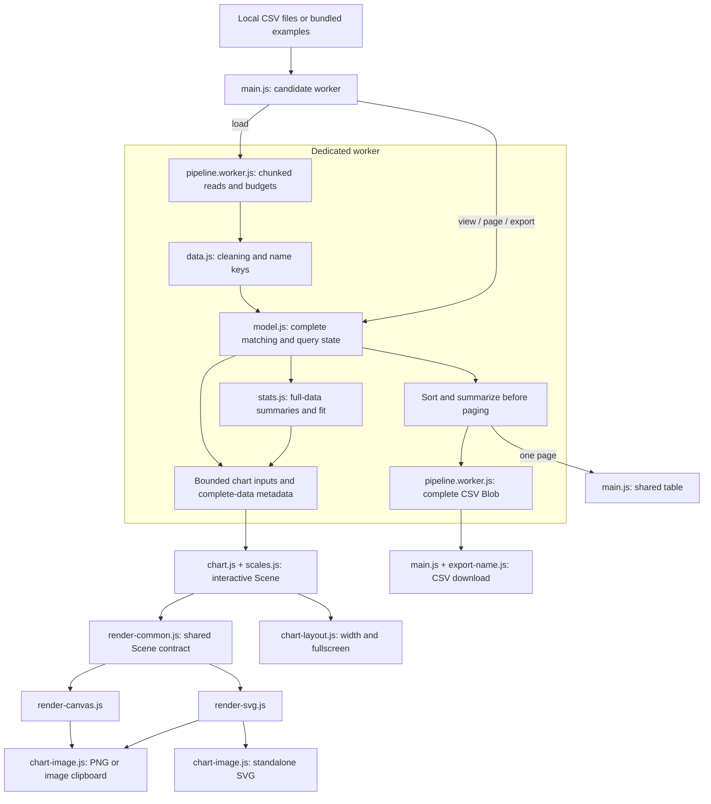

# Architecture

This overview helps contributors locate code, follow data across the page/worker
boundary and understand which data a chart, statistic or export represents.

**Applies to:** `main` at `ef757cb`, with the #17/#23 documentation update ·
**Files:** [`src/`](../src), [`index.html`](../index.html), [`styles.css`](../styles.css) ·
**Related:** [#17](https://github.com/CSE-210-Farleys-Eleven/Warmup-Site/issues/17),
[#23](https://github.com/CSE-210-Farleys-Eleven/Warmup-Site/issues/23)

## Overview

Steps & Sleep is a static HTML/CSS/JavaScript application. The browser displays
two per-file line charts and a scatter pairing file A's Y with file B's X.
There is no application backend, database or upload endpoint. The page fetches
bundled example CSVs; selected local files remain in browser memory.

The main thread owns controls and drawing. A dedicated module worker reads,
cleans, matches and summarizes complete datasets, then returns bounded drawing
payloads or one table page. CSV serialization also runs in that worker.

## Module map

| File in `src/` | Responsibility and boundary |
| --- | --- |
| [`main.js`](../src/main.js) | Page entry point. Binds controls, owns active/candidate workers and request versions, recreates chart handles, paints metrics/table cells and starts CSV downloads. |
| [`pipeline.worker.js`](../src/pipeline.worker.js) | Worker entry point. Streams browser Files, enforces shared import budgets, owns the model and handles load/view/page/export/cancel-export messages. |
| [`data.js`](../src/data.js) | Shared CSV cleaning and normalized group-name keys. Direct text parsing and worker-parsed rows reuse `buildFromParsed`; its optional Node entry writes `data/result.json`. |
| [`model.js`](../src/model.js) | DOM-free full-data matching, independent chart exclusions, summaries, precision/fingerprint metadata, drawing samples and cached/sorted/paged tables. |
| [`stats.js`](../src/stats.js) | Fit/correlation, grouped summaries and the synchronous chart stats-provider hook. Undefined statistics use NaN. |
| [`chart.js`](../src/chart.js) | Interactive chart controller. Builds a pixel-coordinate Scene, handles legends/hover/zoom/pan/scales, selects a renderer and owns layout/image cleanup. |
| [`scales.js`](../src/scales.js) | Pure linear/log transforms, extents, tick formatting and measured category-label spacing. |
| [`render-common.js`](../src/render-common.js) | Shared Scene/Renderer contracts and categorical marker shapes/colors. |
| [`render-canvas.js`](../src/render-canvas.js) | Paints a Scene into a DPR-scaled canvas and repaints on system-theme changes. |
| [`render-svg.js`](../src/render-svg.js) | Builds a Scene as SVG nodes, clips data to the plot, and supports highlight/hover state. |
| [`chart-layout.js`](../src/chart-layout.js) | Main-thread maximum-width controls and native/in-page fullscreen lifecycle. |
| [`chart-image.js`](../src/chart-image.js) | Current-view PNG/clipboard and standalone SVG export. Copies computed SVG styles and supplied tooltip text into exported images. |
| [`export-name.js`](../src/export-name.js) | Pure CSV filename construction from dataset labels, source/display/filter scope, complete row count and the model fingerprint. |
| [`vendor/papa.js`](../src/vendor/papa.js) | Vendored Papa Parse 5.7.0 with a local ESM wrapper; avoids a runtime CDN dependency. |
| [`vendor/LICENSE-papaparse`](../src/vendor/LICENSE-papaparse) | Papa Parse's MIT license, included in the published assets. |

`index.html` declares the controls and empty chart/table containers. `styles.css`
owns responsive layout, sticky bars and system light/dark color tokens.
`data/` contains examples and parser fixtures, not user uploads.

## Data flow

Requests have numeric correlation ids. Progress replies leave a request pending;
result/error replies settle it. Import/view/page version counters prevent stale
responses from replacing newer state. See the [worker protocol](data-pipeline.md#worker-protocol).

## Decisions

- **Atomic imports:** a new candidate worker replaces the active worker only after
  both files parse successfully. Failed or cancelled imports normally retain the
  prior dataset. Import cancellation terminates the candidate worker.
- **Separate analysis and drawing:** a chart receives at most 3,000 selected points;
  metrics, table queries and CSV use complete selected rows. More than 20 visible
  line groups force explicitly labelled category means.
- **Independent visibility:** hiding a group affects that chart's source only.
  The shared table/CSV applies exclusions from its selected source, plus the
  common group-name filter. Hidden legend names remain available for restoration.
- **Explicit statistics scope:** worker metric cards/table summaries keep raw-unit
  data regardless of log axes. Unsampled scatter legend/fit uses chart-side
  plottable points and the synchronous provider; sampled scatter fit uses the
  worker's complete selected pair population. Neither is log-space regression.
- **Bounded inspection/export:** DOM tables contain at most 100 rows. CSV includes
  all pages of the selected display and is serialized in cancellable batches.
  PNG dimensions are bounded; SVG export requires an SVG-rendered chart.
- **Owned cleanup:** chart replacement disconnects observers, removes resize/theme
  and fullscreen listeners, and releases renderer/image controls. Layout state
  can transfer across a legend redraw without exiting fullscreen.

## Development and deployment

`server.js` is a small local static server started by `npm start`; it is not a
data-processing backend. `scripts/check-stats.mjs` exercises grouped summaries.
`scripts/ci/` enforces repository hygiene and lint rules from `templates/`.

GitHub Pages stages `index.html`, `styles.css`, `src/` and `data/`. Its deploy job
depends on the reusable CI workflow. Current main runs unit/DOM tests, stats
checks, opt-in JavaScript type checking and changed-file lint. Hygiene is a PR-only
job. As of this base revision, Cypress is proposed in PR #29, not yet part of main.
See [CI](ci.md) for the authoritative commands and branch-rule limitations.

## Limitations

- Input budgets are 5 MiB/file, 20,000 scanned data records/file, 512 value columns
  and 250,000 combined value cells. They reduce pressure rather than guarantee
  performance on every device. The parser still builds cleaned rows in memory.
- A drawing sample is not the complete distribution. Pagination does not bound
  complete model/table memory or the total size of a CSV download.
- The six-character data fingerprint can collide; it is not a security primitive.
- Worker messages are application-internal contracts, not a validated public API.
- A custom provider can make an unsampled scatter legend differ from worker
  metric cards. Sampled fits do not call the page's custom provider.
- DOM tests substitute native drawing/clipboard/fullscreen behavior. A passing
  unit suite is not proof of exported image pixels or real-browser layout.

## Testing and further reading

The [model tests](../test/model.test.js), [worker tests](../test/worker.test.js),
[control tests](../test/controls.test.js), [scale tests](../test/scales.test.js) and
[owned-contract examples](../test/owned-contracts.test.mjs) exercise these boundaries.

- [Data pipeline and inspection contracts](data-pipeline.md): API, messages and examples.
- [Chart layout lifecycle](chart-layout.md): width/fullscreen behavior and cleanup.
- [Contribution record for ex188](contributions-ex188.md): ownership and commit evidence.
- [Renderer/table notes](renderer-and-tables.md): historical PR #4 design and validation.
- [PR #5 review fixes](pr5-review-fixes.md): subsequent sorting, precision and layout work.
- [CI documentation](ci.md): checks and current follow-ups.

The historical PR pages retain their original test counts and validation limits;
they do not replace the current test/CI results. Function contracts follow
[function-headers.md](../templates/function-headers.md); this page follows
[documentation.md](../templates/documentation.md).
