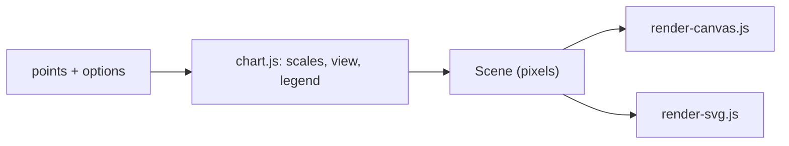

# Canvas and SVG renderers

This page covers how a chart gets from data to pixels: the `Scene` description in [render-common.js](../src/render-common.js), the two renderers that draw it, and the parts of [chart.js](../src/chart.js) and [stats.js](../src/stats.js) that build the scene, switch renderers and switch between linear and log scales. It is for anyone adding a renderer, a mark shape or an axis option. Read Overview, then the section you need.

**Applies to:** `main` through PR #34 · **Files:** [render-common.js](../src/render-common.js), [render-canvas.js](../src/render-canvas.js), [render-svg.js](../src/render-svg.js), [chart.js](../src/chart.js), [stats.js](../src/stats.js) · **Related:** #1, #3, #23, [scales](scales.md), [architecture](architecture.md), [chart image export](chart-image-export.md)

## Overview

`chart.js` never draws. It turns the data, the current view and the legend state into a `Scene`: every tick, mark, line, mean bar and label already in CSS pixels. A renderer only paints that scene. Two renderers exist, so the same chart can be a `<canvas>` (the default) or an `<svg>`. Hover, pan, zoom, the legend, the tooltip and the data table are in `chart.js`, so they behave the same on both.



Colors come from CSS custom properties (`--series-1..8`, `--grid`, `--axis`, ...) in [styles.css](../styles.css), so both renderers follow the light and dark themes. Each marker color also has its own shape, so series stay distinguishable without color.

## Context

PR #1 split the old SVG-only `chart.js` into a renderer-neutral scene and two drawing backends, and added independent linear/log scales per axis. PR #3 added UI controls on top and was reverted; Yinuo restored the helpers the revert removed (`4c975c8`). See [renderer and table notes](renderer-and-tables.md) for the branch history.

## API: render-common.js

### Types

| Type | What it is |
| --- | --- |
| `Scene` | Everything a renderer needs, in CSS pixels: `width`, `height`, `plot` box (`left`, `right`, `top`, `bottom`), `xTicks` and `yTicks` (`{px, text}`), `xLabel`, `yLabel`, `trend` polyline or `null`, `lines`, `marks`, `means` and `ariaLabel`. |
| `SceneMark` | One drawn point: pixel position `px`, `py`, its color/shape `slot`, its `group` and the original `mark` for hit-testing. |
| `SceneMean` | One mean bar: `x0`, `x1`, `y` and the original `mean`. |
| `Renderer` | `{el, draw(scene), setHover(pos), setHighlight(group), destroy()}`. `el` is the element to put in the page. |

### Constants

| Name | Value | Meaning |
| --- | --- | --- |
| `POINT_R` | `5` | marker radius in pixels (10 px markers) |
| `SERIES_SLOTS` | `8` | distinct colors and shapes; later groups share `--series-other` |
| `MEAN_HALF_WIDTH` | `0.3` | half width of a mean bar in x units; a log x axis uses a fixed pixel width instead |

### `seriesVar(slot)`, `colorFor(slot)`

The CSS custom property name for a series slot, and `var(...)` of it for SVG attributes. Slots from `SERIES_SLOTS` up use `--series-other`. A negative slot gives a name that styles.css does not define.

```js
[seriesVar(0), seriesVar(7), seriesVar(8), colorFor(2)]
// => ['--series-1', '--series-8', '--series-other', 'var(--series-3)']
```

### `shapePath(slot, r)`

SVG path data for a marker shape centered on (0, 0); position it with a transform. The same string works for `new Path2D(...)`, so both renderers share it. Slots from `SERIES_SLOTS` up get a circle.

| Slot | Color | Shape |
| --- | --- | --- |
| 0 | blue | circle |
| 1 | orange | square |
| 2 | aqua | triangle |
| 3 | yellow | diamond |
| 4 | magenta | triangle |
| 5 | green | circle |
| 6 | violet | diamond |
| 7 | red | cross |

The pairs that are easy to confuse (orange/red/green, blue/violet, aqua/green, orange/yellow) never share a shape.

```js
shapePath(1, 5)
// => 'M-4.5,-4.5H4.5V4.5H-4.5Z'
```

## API: the renderers

### `createCanvasRenderer()` and `createSvgRenderer()`

Each returns a `Renderer`. Nothing is drawn until `draw(scene)` is called.

| Method | Canvas renderer | SVG renderer |
| --- | --- | --- |
| `el` | a `<canvas>` with `role="img"` | an `<svg>` with `role="img"` |
| `draw(scene)` | repaints the whole frame, sized for the device pixel ratio; clears the hover ring | rebuilds every child of the `<svg>`; the hover ring comes back hidden |
| `setHover(pos)` | stores the ring position and repaints; `null` removes it | shows or hides the ring; does nothing before the first `draw` |
| `setHighlight(group)` | dims every other group to 15% (lines 12%) and repaints; `null` clears | adds a `dimmed` class to every other group's elements |
| `destroy()` | removes the color-scheme listener and the canvas | removes the `<svg>` |

Drawing order, both renderers: grid, tick labels, axis lines, axis titles, then (clipped to the plot) trend line, series lines, markers, mean bars, hover ring.

**Edge cases:** neither renderer throws on an empty scene. `setHover` and `setHighlight` before `draw` only store state. Several SVG renderers can share a page: each gets its own clip-path id.

```js
const svg = createSvgRenderer();
svg.draw(scene);                 // scene with two marks, groups 'A' and 'B'
svg.el.querySelectorAll('path.point').length
// => 2
svg.setHover({px: 100, py: 50}); // ring visibility: 'hidden' -> 'visible'
svg.setHighlight('A');
svg.el.querySelectorAll('path.point.dimmed').length
// => 1
```

**Side effects:** the canvas renderer adds a `prefers-color-scheme` listener (removed by `destroy`) so colors read at draw time follow the OS theme. Call `destroy` when a chart is replaced.

### `svgEl(tag, attrs = {}, parent)`

Creates an SVG-namespace element, sets its attributes (converted with `String`) and appends it to `parent` when given. Throws an `InvalidCharacterError` for an invalid tag name.

```js
svgEl('line', {x1: 0, x2: 10, y1: 5, y2: 5}, svg.el).parentNode === svg.el
// => true
```

## API: chart.js pieces

These live inside `drawScatter(container, input, options)` unless noted. They are the log-scale and renderer-switching code from PR #1.

| Function | Does |
| --- | --- |
| `computeMeans(marks)` (module level) | Mean y for each distinct, un-jittered x. |
| `placeMarks()` | Sets each mark's drawn position. Jitter is added on a linear x axis and multiplied on a log one, so it never pushes a point to zero or below. |
| `homeX()`, `homeY()` | The starting view of each axis, in t-space. A category x axis gets half a unit of room on each side. |
| `countUnplottable()`, `reportHidden()` | Count the visible points the current scales cannot draw (zero or negative on a log axis) and pass the number to `options.onHidden`. |
| `tickList(axis)` | Gridline positions and labels: `logTicks` on a log axis, `niceTicks` on a linear one, every n-th category on a category x axis. |
| `buildScene()` | Builds the `Scene`. Leaves out hidden groups and unplottable points. The trend line uses 2 points when both axes are linear and 64 when either is log, because a straight line is a curve on a log axis. |
| `render()` | `buildScene()` then `renderer.draw(scene)`; runs on every pan frame. |
| `setRenderer(kind)` | Swaps `'canvas'` and `'svg'`: hides the tooltip, destroys the old renderer, swaps the element and redraws. Does nothing for the same kind. |
| `setScale(axis, kind)` | Switches one axis between `'linear'` and `'log'` and resets **both** axes to the home view (zoom scales both together). Does nothing for the same kind, or for x on a category axis. |

`drawScatter` returns a handle with `setRenderer`, `setScale`, `getState` and `destroy`. `getState()` reports the renderer, both scale kinds, how many points are hidden and the view.

## API: stats provider (stats.js)

The trend line and `r` label come from a replaceable provider.

| Function | Does |
| --- | --- |
| `setStatsProvider(fn)` | Swaps in another statistics function. It must be synchronous and return NaN, not throw, when the fit is undefined. Call with no argument to restore the built-in one. |
| `computeStats(points)` | Stats for the points plotted now, from the active provider. |

```js
computeStats([{x: 1, y: 2}, {x: 2, y: 4}, {x: 3, y: 5}, {x: 4, y: 8}])
// => {n: 4, r: 0.9811557810392123, slope: 1.9, intercept: 0, r_squared: 0.9626666666666667}
computeStats([{x: 1, y: 1}]).slope
// => NaN
```

## Design

1. `drawScatter` filters out non-finite points, picks the scale kinds and the renderer from `options`, and builds the legend and DOM.
2. `render()` calls `buildScene()`: scales from [scales.js](scales.md), tick lists, visible marks, trend line, lines (when `connectGroups`) and mean bars.
3. The renderer draws the scene. Interaction code reads `scene.marks` and `scene.means` for hit-testing, so it does not care which renderer drew them.
4. Pan and zoom change the view and call `render()` again. Hover and legend highlight call `setHover` and `setHighlight` only.

## Decisions

- **Scene instead of two chart implementations.** Listeners sit on the wrapping `div`, not the `<svg>`, so switching renderers does not rebind them.
- **Canvas is the default, SVG stays available.** Save SVG only works on the SVG renderer, and keeps each point's tooltip as a hover label ([chart image export](chart-image-export.md)).
- **Redraw the whole canvas on hover.** The data is small, and a full repaint avoids tracking dirty regions.
- **Reset both axes when a scale changes.** Zoom scales both axes together, so resetting one would leave the other zoomed (`4aa4042`, Y1).

## Limitations

- The canvas renderer reads colors and the font family once per draw, from the canvas element's computed style, so a CSS change shows up on the next draw, not instantly.
- Points a log axis cannot show are not drawn. They are counted and reported through `onHidden`, not listed.
- `render-canvas.js` has no direct unit test: it needs a real 2D context, so only `controls.test.js` exercises it, with a fake one.

## Testing

[renderers.test.js](../test/renderers.test.js) runs the SVG renderer, `svgEl` and the shape helpers in jsdom. [scales.test.js](../test/scales.test.js) covers the scale code and the stats provider swap. [controls.test.js](../test/controls.test.js) covers `setScale` while zoomed and the Canvas and SVG export paths.

```sh
npm test
```

## Follow-ups

- [ ] Test `createCanvasRenderer` against a recording 2D context.
- [ ] List the points a log axis hides, not only count them.
